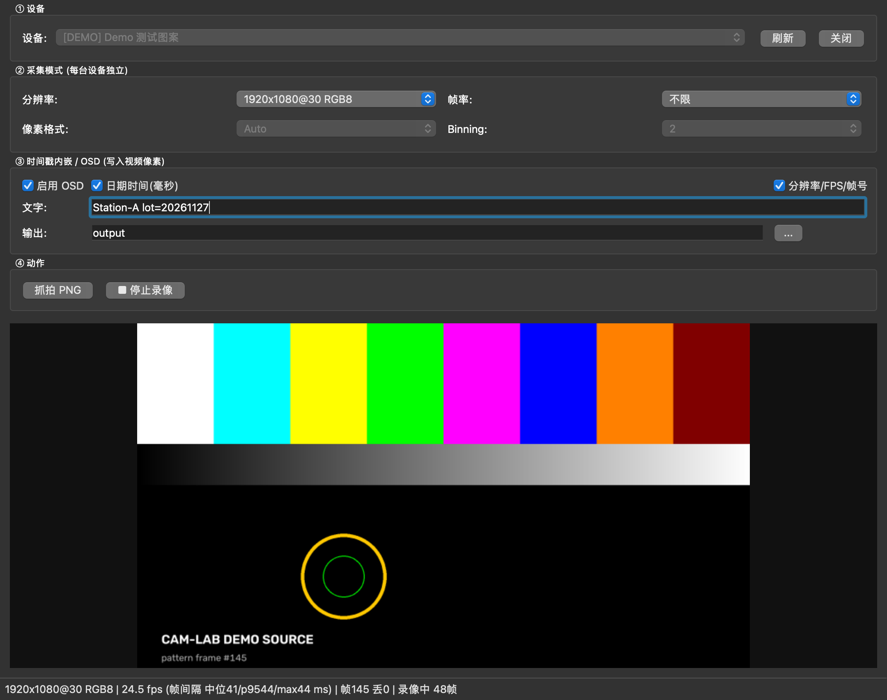

# Cam-Lab — 多后端相机采样/预览/录像平台

**English** | A cross-platform camera capture lab: multi-backend device discovery,
per-device resolution/framerate control, live FPS stats, snapshot testing and
video recording with **burned-in timestamp OSD**. macOS / Linux / Windows.

---

**Cam-Lab** 是一个面向工业相机与 USB 免驱动相机的采样实验平台，把「设备枚举 →
模式选择 → 预览调参 → 抓拍/录像」做成一条顺滑的流水线。

## 界面预览



> 截图为无硬件 `demo` 虚拟设备(彩条测试图案)，实机接入 UVC/海康相机后界面一致。

## 功能

- **多后端设备发现** — 自动聚合不同来源的设备:
  | 后端 | 覆盖 | 说明 |
  |---|---|---|
  | `uvc` | USB 免驱动相机 (UVC 协议) | OpenCV 采集: macOS AVFoundation / Windows DirectShow / Linux V4L2, 即插即用 |
  | `mvs` | 海康威视/海康机器人工业相机 (GigE / USB3) | 自研 MVS SDK ctypes 绑定(仓库不含 SDK 本体, 装好官方 Runtime 即自动识别) |
  | `demo` | 无硬件虚拟信号源 | 彩条/渐变/动效测试图案, 零硬件体验与开发调试 |
- **每台设备分辨率独立可调** — 模式列表按设备生成, 分辨率/帧率/像素格式/Binning
  分开选择, 打开后回读**实际协商值**(不撒谎)
- **帧率实时显示** — 平滑 FPS + 帧间隔分布(中位/P95/最大), 卡顿一眼可见
- **抓拍测试** — 一键保存 PNG (干净原帧)
- **视频采样 + 字符时间戳内嵌** — 日期时间(毫秒)/设备/模式/FPS/帧号/自定义文字
  在**写入像素**后落盘, 回放即见, 不依赖播放器字幕; 支持自定义文字与分段录像
- **双入口** — PySide6 图形界面 + 无头 CLI(自动化测试/采集脚本)
- **文件名自描述** — `rec_20261127_132227_1280x720@30_MJPG_30fps_1280x720.mp4`

## 快速开始

```bash
pip install -r requirements.txt          # numpy / opencv-python / PySide6

# 图形界面
python -m camlab                          # 或: camlab gui

# 命令行
python -m camlab probe                    # 枚举所有设备
python -m camlab grab -b uvc -m "1280x720@30 MJPG" -n 30      # 抓帧测试
python -m camlab record -b uvc -t 10 --text "Station-A"       # 录像+时间戳内嵌
python -m camlab record -b mvs -d 0 -m "2448x2048" --binning 2 -t 15
```

十行最小示例见 [`examples/minimal_preview.py`](examples/minimal_preview.py)。

## MVS 后端安装(可选)

海康工业相机需要先安装 [MVS SDK Runtime](https://www.hikrobotics.com/) (免费):

| 平台 | 位置 |
|---|---|
| macOS | `/Library/Frameworks/MvCameraControl.framework` (安装 Runtime.pkg) |
| Linux/Jetson | `/opt/MVS/lib/{aarch64,x86_64}/libMvCameraControl.so` |
| Windows | `MvCameraControl.dll` (安装 MVS 后自动加入 PATH) |

未安装 SDK 时 `mvs` 后端自动隐藏, 不影响 UVC 使用。

### GigE 相机提示

千兆链路全分辨率帧率上限 ≈ 125MB/s ÷ 每帧字节数 (2448x2048@Mono8 ≈ 24fps)。
出现横向黑线 = 丢包: 确认 `GevSCPSPacketSize` ≤ 网卡 MTU (默认 1500 安全;
开巨型帧 MTU 9000 后可设 8164 提速), 本项目打开 GigE 设备时已自动做这两项防护。

## 架构

```
camlab/
├── base.py          # Backend / CaptureSession / DeviceInfo / Mode 抽象
├── registry.py      # 后端注册器: 设备聚合, 新后端一行接入
├── stats.py         # FpsCounter: 平滑FPS + 帧间隔分位数
├── overlay.py       # OSD/时间戳渲染 (帧内嵌, ASCII 自适应字号)
├── recording.py     # RecorderThread: 后台写盘/分段/丢帧计数
├── backends/
│   ├── uvc.py       # OpenCV UVC (macOS/Win/Linux), 模式表+应用即校验
│   ├── demo.py      # 无硬件虚拟信号源(彩条/动效测试图案)
│   └── mvs/         # 海康 MVS: api.py(最小ctypes绑定) + backend.py(能力/会话)
├── gui.py           # PySide6 主窗口
└── cli.py           # probe / grab / record / gui
```

新增一个后端 = 实现 `camlab.base.Backend` 的 3 个类方法 + 在
`registry._load_builtin()` 追加一行, UI/CLI 无需改动。

## 已验证平台

| 平台 | 后端 | 状态 |
|---|---|---|
| macOS (Apple Silicon / Intel) | UVC(内置摄像头) / MVS(GigE) | ✅ 采集/预览/录像/时间戳内嵌实测通过 |
| Linux (x86_64, Jetson aarch64) | UVC(V4L2) / MVS | 代码就绪, 路径/权限见下 |
| Windows | UVC(DirectShow) / MVS | 代码就绪 |

Linux/Jetson 提示: GigE 枚举需 raw socket 权限 `sudo setcap cap_net_raw+ep $(which python3)`;
MTU/socket 缓存/rp_filter 配置同海康《网口工业相机丢包排查手册》。

## Roadmap

- [ ] UVC 真实模式枚举 (macOS AVFoundation / Windows DShow / Linux v4l2-ctl)
- [ ] 多设备同屏预览
- [ ] MJPEG 直写(不转码, 高分辨率低 CPU)
- [ ] 采集帧回调插件(推理/质检钩子)

## License

[MIT](LICENSE)
